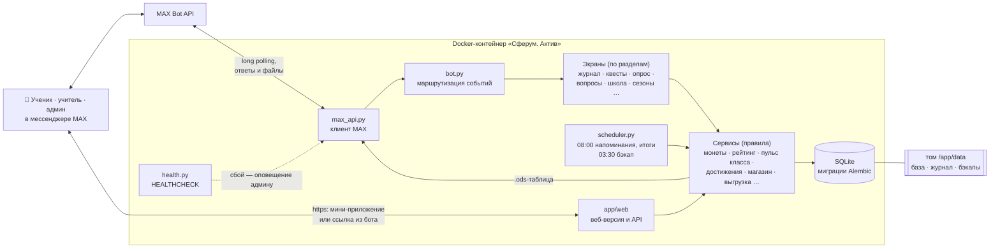

# Сферум. Актив — бот геймификации школы для MAX

[](https://github.com/decoderus/ideya_fiks_47_bot/actions/workflows/tests.yml)

Чат-бот для мессенджера MAX: ученики выполняют квесты (учебные, творческие, спортивные, общественные),
получают монеты и достижения, соревнуются в рейтинге и тратят монеты в школьном магазине наград.
Учителя и администрация создают квесты, проверяют ответы и видят статистику.

## Для жюри

### Посмотреть бота прямо сейчас

**Демо-бот уже запущен из этого Docker-образа и работает круглосуточно:
[max.ru/ideya_fiks_47_bot](https://max.ru/ideya_fiks_47_bot)** — откройте его в MAX и нажмите «Старт».
Ничего устанавливать не нужно.

Настоящий бот уже работает и проходит проверку в школе — **@demo_active_bot** в MAX.
Демо-бот — его копия: образ по умолчанию работает в **демо-режиме**: при первом запуске бот получает обезличенную копию
его базы — 20 классов, около 100 вымышленных учеников с балансами, выполненными
квестами, сериями, достижениями и итогами соревнования классов, квесты и награды с картинками,
несколько ответов, ожидающих проверки. Реальных людей в базе нет, и сообщения вымышленным
пользователям никуда не отправляются.

### Запустить у себя за одну команду

Нужен **свой** токен бота MAX: токен @ideya_fiks_47_bot уже занят работающим демо-ботом,
а два экземпляра с одним токеном мешают друг другу.

Готовый образ на Docker Hub — [kotzzz/sferum-aktiv](https://hub.docker.com/r/kotzzz/sferum-aktiv)
(токена в нём нет — передайте свой):

```bash
docker pull kotzzz/sferum-aktiv:1.0
docker run -d --name sferum-aktiv -e BOT_TOKEN=<токен бота MAX> -v aktiv-data:/app/data kotzzz/sferum-aktiv:1.0
```

Или соберите образ сами из этого репозитория:

```bash
docker build -t sferum-aktiv:1.0 .
docker run -d --name sferum-aktiv -e BOT_TOKEN=<токен бота MAX> -v aktiv-data:/app/data sferum-aktiv:1.0
```

### Что попробовать в боте

Дальше в MAX:
1. Откройте бота и нажмите «Старт» — вы сразу войдёте **админом** (без регистрации):
   вся школа — классы, учителя, награды, оповещения, статистика, сезоны, журналы.
2. Команда **/demo** меняет роль в любой момент:
   - **👩‍🏫 Учитель** — «📋 На проверке» (ответы ждут решения), «📂 Квесты» → «➕ Новый квест», «💰 Монеты»;
   - **🎒 Ученик** — квесты, «🛒 Магазин» (на счёте 1000 монет), «🏆 Рейтинг», «🏅 Достижения», профиль;
   - **🛡 Модератор** — помощник админа без денежных операций.

Для настоящей школы демо-режим выключается: `-e DEMO=false -e DEMO_DB=` (бот начнёт с пустой базы).
Код у рабочего бота школы и у демо-бота один и тот же: в рабочем боте `DEMO` выключен, и `/demo` не работает ни у кого, включая администратора.

## Команда

Проект разрабатывает школьная команда хакатона «Идея фикс» — ученики 10 класса и их руководитель:

| Участник | Роль в проекте |
|---|---|
| **Белоусов** | разработчик |
| **Спиваков** | разработчик |
| **Пивень** | разработчик |
| **Бурмистрова** | геймдизайнер |
| **Савин** | тестировщик |
| **Коцур С. Н.**, учитель информатики | руководитель и наставник (капитан команды), старший разработчик: формулирует общее видение проекта и технические задания для команды — роль тимлида |

Ученики не только разрабатывают бота, но и работают с ним каждый день: в рабочем боте школы у них роль
**модераторов** — проверяют ответы учеников, отвечают на вопросы, готовят квесты и оповещения
(публикуются после подтверждения администратора).

Бот работает в школе с 18 октября 2026 года: им уже пользуются 89 учеников и 9 учителей.

## Чем отличается от похожих решений

| Решение | Что делает | Чего в нём нет и что есть у нас |
|---|---|---|
| **«Награды» в Сферуме** | Значки за достижения, которые педагог вручает ученику | Значок — разовое поощрение. У нас полный игровой цикл: задание → доказательство (фото, видео, текст) → проверка → монеты → магазин школьных привилегий → рейтинг, сезоны и соревнование классов |
| **«Переменка» в Сферуме** | Игры и викторины для перерыва | Развлечение внутри экрана. Мы мотивируем на дела в реальной жизни: зарядку, помощь дома, участие в конкурсах, идеи для школы |
| **Электронный дневник** | Оценки, расписание, задания | Учитывает учёбу. Мы отмечаем добровольную активность и не влияем на оценки |
| **ClassDojo и похожие зарубежные сервисы** | Баллы за поведение от учителя | Отдельное приложение и зарубежные серверы. У нас — в MAX, где школа уже общается, данные хранятся в России; ученик сам выбирает задания и тратит монеты |
| **Баллы на бумаге или в таблице** | Учитель ведёт учёт вручную | Нет обратной связи и прозрачности. У нас всё мгновенно и видно ученику: баланс, история, место в рейтинге |

Главное отличие — бот уже работает в настоящей школе: ученики выполняют квесты каждый день,
учителя проверяют ответы, классы соревнуются. Защита от злоупотреблений встроена в правила:
лимиты учителей, проверка ответов, журнал действий персонала.

## Возможности

У каждой роли своё меню и своя справка «ℹ️ Помощь» (`/help`): при первом входе она первая кнопка
меню, после просмотра переезжает в конец. На любом экране есть кнопка «🏠 В меню».

**Ученик**
- 👤 Профиль: баланс, место в рейтинге, выполненные квесты, серии, последние достижения.
- 🎯 Квесты: с автоподтверждением или с ответом на проверку (текст, фото, видео); ежедневные,
  еженедельные и ежемесячные квесты с сериями; «Вопрос дня».
- 🛒 Магазин: награды за монеты, «Мои покупки» со статусами.
- 🏆 Рейтинг: школа и классы, сезоны (четверти) с архивом итогов.
- 🏅 Достижения и 📣 оповещения от школы.
- 🌟 Мои успехи (в профиле): успехи, которые отметили учителя, — с уведомлением о каждой новой записи.
- Утренние напоминания о сериях (можно отключить кнопкой «🔕 Не напоминать»).
- ❓ Вопрос под любым квестом — по заданию или по проверке ответа, а кнопкой
  «❓ Задать вопрос» в меню — общий вопрос модераторам и администраторам.
  Ответ приходит в чат с именем и ролью ответившего.

**Учитель**
- Создание и редактирование квестов для своих классов (с картинкой), проверка ответов.
  Квесты учителя — с ответом на проверку и плавающей наградой 50–150 монет:
  точную сумму выбирает проверяющий.
- Начисление монет ученику или всему классу (лимиты: 150 за раз, 1000 в сутки).
- 📒 Журнал успехов: «✍️ Отметить успех» любого ученика школы — область (учёба, олимпиады,
  спорт, творчество, общественная жизнь, другое) и описание; ученику своего класса — сразу
  с монетами. Записи всех учителей копятся в карточке ученика: видно, в чём он силён.
- «Пульс класса» — первый экран класса в журнале: сколько учеников активны за неделю
  (и сравнение с прошлой), место и допуск в соревновании, серии, успехи и достижения за неделю,
  списки «😴 не участвуют 2+ недели» и «⚠️ ответ отклонён и не пересдан» — где учителю действовать.
- «📥 Выгрузить в таблицу»: файл LibreOffice Calc (.ods, открывается и в Excel, Google Таблицах)
  по своему классу за 7 дней, 30 дней или всё время — листы «Сводка», «Успехи», «Монеты».
  Админ выгружает любой класс или всю школу. Файл собирается без сторонних библиотек
  (`app/services/ods.py`) и приходит прямо в чат.
- Выдача покупок, ученики своих классов.
- «❓ Вопросы»: вопросы учеников по своим квестам и ответы на них.

**Администратор и модератор**
- Компактное меню: «📂 Квесты» (с созданием внутри), «🏫 Школа» (классы и учителя),
  «🎁 Награды» (магазин и выдача), «📊 Статистика» (с регистрациями и журналами).
  На кнопке — число того, что ждёт действия: «🎁 Награды · 3», «📊 Статистика · 5».
- Классы, учителя, регистрации, роли, награды магазина, сезоны.
- Оповещения всей школе, классу или лично (текст, фото, голосовое).
- Статистика, журналы «Движение монет» и «Действия персонала».
- «📋 Опрос учеников и учителей» (в статистике): 4 вопроса кнопками и пожелание, ученику —
  +100 монет за участие. Повторная отправка — только тем, кто ещё не прошёл; у прошедших
  кнопка «📋 Опрос» исчезает из меню. Итоги анонимные: доли ответов, NPS, пожелания.
- «❓ Вопросы» учеников по всем квестам. Если ответил учитель или модератор,
  админ может уточнить ответ.
- Модератор работает с интерфейсом админа, но без денежных операций; его квесты
  (с проверкой, награда 50–300) и оповещения публикуются после подтверждения админа.

**Веб-версия** (кнопка «🌐 Веб-версия» в меню, `app/web`)
- Ученик: профиль, успехи из журнала, рейтинг школы и класса. Учитель, модератор, админ: «пульс»
  любого класса и рейтинг — удобно с компьютера.
- Вход: в рабочем боте — как мини-приложение MAX (подпись MAX проверяется токеном бота), в любом
  боте — по одноразовой ссылке из бота (действует 10 минут, годится один раз). Только чтение:
  всё, что меняет монеты и квесты, делается в боте.

**Автоматически по расписанию (Москва)**
- 08:00 — напоминания о сериях; итоги соревнования классов (понедельник — за неделю,
  1-е число — за месяц) и итоги закончившегося сезона.
- 03:30 — резервная копия базы (хранится 14 дней).

## Быстрый старт в Docker

Нужны: Docker 24+ и токен бота MAX (выдаётся на платформе MAX для партнёров,
см. [инструкцию](https://dev.max.ru/docs/chatbots/bots-coding/prepare)).

### 1. Настройки

```bash
cp .env.example .env        # Windows: copy .env.example .env
```

Откройте `.env` и заполните:

| Переменная  | Что это |
|-------------|---------|
| `BOT_TOKEN` | токен бота MAX (обязательно) |
| `ADMIN_IDS` | MAX user_id администраторов через запятую; свой id бот покажет по команде `/id` |

Остальные настройки в образе уже заданы, менять их не нужно.

### 2. Сборка образа

```bash
docker build -t sferum-aktiv:1.0 .
```

Вместо сборки можно скачать готовый образ: `docker pull kotzzz/sferum-aktiv:1.0`
(тогда в командах ниже используйте имя `kotzzz/sferum-aktiv:1.0`).

### 3. Запуск контейнера

```bash
docker run -d --name sferum-aktiv --restart unless-stopped \
  --env-file .env \
  -v aktiv-data:/app/data \
  -p 8080:8080 \
  sferum-aktiv:1.0
```

Веб-версия откроется по кнопке «🌐 Веб-версия» в боте (адрес `http://localhost:8080`; для доступа
из интернета задайте `WEB_URL` с https-адресом сервера).

Windows PowerShell (одной строкой):

```powershell
docker run -d --name sferum-aktiv --restart unless-stopped --env-file .env -v aktiv-data:/app/data -p 8080:8080 sferum-aktiv:1.0
```

То же через Docker Compose (сборка и запуск одной командой):

```bash
docker compose up -d --build
```

### 4. Проверка

```bash
docker logs -f sferum-aktiv
```

В журнале должно появиться:

```
... INFO aktiv: Бот запущен: @имя_бота (id ...)
... INFO aktiv: Плановые задачи: расписание запущено
```

Дальше в MAX:
1. Напишите боту `/id` — он пришлёт ваш user_id. Впишите его в `ADMIN_IDS` в `.env`
   и пересоздайте контейнер (`docker rm -f sferum-aktiv`, затем команда из шага 3).
2. Напишите `/start`, введите фамилию и имя — откроется меню администратора.
3. Добавьте классы в «🏫 Классы» — без них ученики не смогут зарегистрироваться.
4. Роли назначает админ: `/role <user_id> <admin|moderator|teacher|student>`.

### Управление контейнером

```bash
docker stop sferum-aktiv       # остановка (бот дописывает начатые рассылки, до 30 с)
docker start sferum-aktiv      # запуск
docker restart sferum-aktiv    # перезапуск
docker rm -f sferum-aktiv      # удалить контейнер (данные в томе aktiv-data сохраняются)
```

### Здоровье и оповещения о сбоях

- **HEALTHCHECK.** После каждого успешного обращения к MAX бот записывает признак жизни
  (`/app/data/heartbeat.json`). Docker раз в минуту проверяет его командой `python -m app.health`:
  если бот больше 2 минут не был на связи с MAX, контейнер получает статус `unhealthy`.
  ```bash
  docker ps                                                     # STATUS: Up … (healthy)
  docker inspect --format '{{.State.Health.Status}}' sferum-aktiv
  ```
- **Оповещения администраторам в личные сообщения MAX:**
  - бот перезапустился после сбоя — когда был на связи в последний раз и сколько длился перерыв;
  - MAX не отвечал боту дольше 3 минут — сообщение приходит, как только связь вернётся;
  - ошибка при обработке действия пользователя — не чаще раза в час, со счётчиком ошибок.

  Получатели — все администраторы из базы или только те, кто указан в `ALERT_IDS`.

### Данные

Все изменяемые данные лежат в томе `aktiv-data` (в контейнере — `/app/data`):

```
/app/data/aktiv.db          база SQLite (схема обновляется автоматически при запуске)
/app/data/logs/audit.log    журнал действий администраторов и модераторов
/app/data/backups/          ежедневные копии базы
```

Скопировать базу из контейнера:

```bash
docker cp sferum-aktiv:/app/data/aktiv.db ./aktiv-copy.db
```

### Тесты в контейнере

```bash
docker run --rm sferum-aktiv:1.0 python -m pytest -q
```

### Образ одним файлом

```bash
docker save sferum-aktiv:1.0 -o sferum-aktiv.tar      # сохранить
docker load -i sferum-aktiv.tar                       # загрузить на другом компьютере
```

## Запуск без Docker

Python 3.13:

```bash
python -m venv .venv
source .venv/bin/activate          # Windows: .venv\Scripts\activate
pip install -r requirements.txt
cp .env.example .env               # и заполните BOT_TOKEN, ADMIN_IDS
python check_token.py              # проверка токена: код 200 и данные бота
python -m app.main                 # запуск бота
```

Без Docker плановые задачи запускаются отдельно (на сервере — таймерами systemd из `deploy/`):

```bash
python -m app.reminders            # напоминания о сериях
python -m app.contests             # итоги соревнований и сезонов
python deploy/backup.py            # копия базы (пути: BACKUP_DB, BACKUP_DIR)
```

Либо задайте `SCHEDULER=true` в `.env` — тогда расписание запустит сам бот, как в Docker.

Тесты: `pytest`

## Настройки (переменные окружения)

| Переменная      | По умолчанию | В Docker-образе | Описание |
|-----------------|--------------|-----------------|----------|
| `BOT_TOKEN`     | —            | —               | токен бота MAX |
| `ADMIN_IDS`     | пусто        | —               | user_id администраторов через запятую |
| `MAX_API_BASE`  | `https://platform-api2.max.ru` | | адрес API MAX |
| `DATABASE_URL`  | `sqlite+aiosqlite:///./aktiv.db` | `…////app/data/aktiv.db` | база данных |
| `AUDIT_LOG`     | `logs/audit.log` | `/app/data/logs/audit.log` | журнал действий персонала |
| `CA_BUNDLE`     | системные сертификаты | `/app/certs/ca-bundle.pem` | сертификаты для HTTPS (с корневым Минцифры) |
| `SCHEDULER`     | `false`      | `true`          | запускать плановые задачи внутри бота |
| `HEARTBEAT_FILE` | `logs/heartbeat.json` | `/app/data/heartbeat.json` | признак жизни для HEALTHCHECK и распознавания сбоев |
| `ALERT_IDS`     | пусто        | пусто           | кому писать о сбоях (MAX user_id через запятую); пусто — всем админам |
| `DEMO`          | `false`      | `true`          | демо-режим: выбор роли командой `/demo`. Запускается только на обезличенной или пустой базе: на базе с настоящей школой бот откажется стартовать |
| `DEMO_DB`       | пусто        | `/app/demo/aktiv-demo.db` | база, которая копируется при первом запуске, если своей ещё нет |
| `WEB_PORT`, `WEB_HOST` | `0` (выключен), `127.0.0.1` | `8080`, `0.0.0.0` | веб-интерфейс (`app/web`) |
| `WEB_URL`       | пусто        | пусто           | внешний адрес веб-версии с https:// — для кнопки «🌐 Веб-версия» и мини-приложения MAX |
| `WEB_SECRET`    | пусто        | пусто           | ключ подписи ссылок и сессий веб-версии; пусто — выводится из токена бота |
| `BACKUP_DB`, `BACKUP_DIR` | пути сервера | `/app/data/…` | что и куда копирует `deploy/backup.py` |

## Архитектура



Бот устроен в три слоя, и каждый отвечает за своё:

| Слой | Что делает | Где лежит |
|---|---|---|
| **Экраны** | Что видит пользователь: текст и кнопки, шаги диалога. Каждый раздел меню — отдельный модуль | `app/journal.py`, `app/survey_view.py`, `app/questions_view.py`, `app/school_admin.py` … |
| **Сервисы** | Правила школы: кто сколько монет может начислить, как считается рейтинг и соревнование классов, кому «нужна помощь». Ничего не знают о кнопках — их легко тестировать и переиспользовать | `app/services/` (28 модулей) |
| **Данные** | Модели таблиц и миграции: структура базы меняется без потери данных, миграции применяются сами при запуске | `app/db/models.py`, `migrations/` (31 миграция) |

`bot.py` только принимает событие из MAX, определяет пользователя и его роль и передаёт событие нужному экрану.
Маршруты заданы таблицами, а не цепочками условий: `CALLBACK_ROUTES` — какая кнопка в какой раздел
(выбирается самый длинный подходящий префикс), `COMMANDS` — команды, `TEXT_STEPS` — какой экран
принимает текст на текущем шаге диалога. Тест `tests/test_routes.py` проверяет, что каждый обработчик
существует и у каждой кнопки в коде есть маршрут.
Плановые задачи (утренние напоминания, итоги соревнований и сезонов, резервная копия) в Docker
запускает встроенный планировщик, на сервере без Docker — таймеры systemd.

### Как добавить новую функцию

На примере **опроса учеников и учителей** (добавлен за один день, ничего существующего не сломал):

1. **Данные** — модель `SurveyResponse` в `app/db/models.py` и миграция `alembic revision --autogenerate`.
2. **Сервис** — `app/services/survey.py`: вопросы, кто ещё не прошёл, начисление 100 монет, подсчёт NPS.
3. **Экран** — `app/survey_view.py`: прохождение по шагам и итоги для админа; подключается к боту классом-миксином и строкой `"sv:": "_survey"` в таблице маршрутов.
4. **Кнопки и справка** — `app/keyboards.py`, `app/help_texts.py` (тест проверяет, что каждая кнопка меню описана в справке).
5. **Тесты** — `tests/test_survey.py`; CI на GitHub прогоняет их вместе с остальными.

### Надёжность

- **Ошибки сети и MAX**: опрос MAX повторяется после сбоя, лимит MAX «2 сообщения в секунду» соблюдается,
  вложения, которые ещё обрабатываются, отправляются повторно с растущей паузой. Ошибка в одном сообщении не роняет бота.
- **HEALTHCHECK**: Docker видит, что бот перестал отвечать (статус `unhealthy`), а при падении процесса
  перезапускает контейнер (`--restart unless-stopped`). Админ получает оповещение в MAX — о перезапуске
  после сбоя, о недоступности MAX дольше 3 минут и об ошибках при обработке сообщений (не чаще раза в час).
- **Данные**: ежедневная резервная копия (хранится 14 дней), миграции без потери данных, журнал действий персонала.
- **Проверка**: 269 автотестов — бот проверяется целиком на подставном клиенте MAX; при каждом обновлении кода
  [GitHub Actions](https://github.com/decoderus/ideya_fiks_47_bot/actions) прогоняет тесты на чистой машине и собирает Docker-образ.

### Интеграции

- **Сейчас**: MAX Bot API (сообщения, кнопки, картинки, видео, файлы, публикации в канале школы);
  мини-приложение MAX и веб-версия (вход по подписи MAX или одноразовой ссылке); Docker и Docker Hub;
  выгрузка в таблицы LibreOffice / Excel / Google Таблицы (формат OpenDocument).
- **Можно подключить** (архитектура готова — новый сервис и экран): электронный дневник, облачное хранилище для резервных копий, ИИ-помощник для проверки ответов.

## Технологии

- Python 3.13, `httpx` (клиент MAX Bot API, long polling), `asyncio`.
- SQLAlchemy 2 (async) + SQLite (`aiosqlite`), миграции Alembic — применяются при запуске.
- `pydantic-settings` — настройки из окружения и `.env`.
- `pytest`, `pytest-asyncio` — тесты (бот проверяется на подставном клиенте MAX).
- Docker: образ `python:3.13-slim`, запуск от непривилегированного пользователя.

## Структура

```
app/
  main.py          запуск, цикл long polling
  bot.py           ядро: приём событий MAX, таблицы маршрутов (кнопки, команды,
                   шаги диалога), главное меню
  max_api.py       клиент MAX API (лимиты на отправку, загрузка картинок и файлов)
  keyboards.py     меню и кнопки по ролям; help_texts.py — справка по ролям
  экраны разделов — по модулю на раздел:
    quests_view.py    квесты ученика: список, «Выполнено», ответы, вопрос дня
    quest_create.py   создание квеста, подтверждение квестов модераторов, «Мои квесты»
    quest_edit.py     редактирование квеста
    review_view.py    проверка ответов и архив
    rating_view.py    рейтинг школы и классов (contests.py — соревнование классов)
    shop_view.py      магазин, Колесо Фортуны, выдача, управление наградами
    coins_view.py     ручное начисление монет ученику и классу
    broadcasts_view.py оповещения и черновики модераторов
    journal.py        «Журнал успехов», «Пульс класса», выгрузка в таблицу
    survey_view.py, questions_view.py, achievements.py, seasons_view.py,
    school_admin.py, registration.py, channel.py — опрос, вопросы, достижения,
                      сезоны, классы и учителя, регистрация, канал школы
  scheduler.py     расписание плановых задач (в Docker)
  health.py        HEALTHCHECK и оповещения о сбоях
  demo.py          демо-режим: выбор роли, демо-база (demo_view.py — экран)
  reminders.py     утренние напоминания о сериях
  contests.py      итоги соревнования классов и сезонов
  config.py        настройки из окружения
  db/              модели, сессии, миграции при запуске
  services/        бизнес-логика: квесты, монеты, магазин, рейтинг, пульс класса,
                   опрос, выгрузка .ods (ods.py — без сторонних библиотек)…
migrations/        миграции Alembic
deploy/            установка на сервер без Docker (systemd), резервные копии,
                   anonymize.py — обезличенная копия базы для демонстрации
demo/              обезличенная демо-база (aktiv-demo.db)
assets/            картинки квестов и наград
certs/             сертификаты (системные + корневой Минцифры)
tests/             тесты
.github/workflows/ CI: тесты и сборка образа на GitHub Actions
Dockerfile, docker-compose.yml, .dockerignore
```

## Для разработчиков

Миграции: после изменения моделей в `app/db/models.py`

```bash
alembic revision --autogenerate -m "что изменилось"
```

Проверьте файл в `migrations/versions/`. Тест `tests/test_migrations.py` падает,
если модели изменены, а миграция не создана.

Важно:
- Токен передаётся только заголовком `Authorization` и хранится в `.env`, который не попадает в git и в образ.
- Два экземпляра бота с одним токеном мешают друг другу: запускайте только один.
